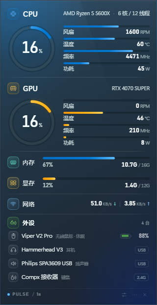

# Pulse

Windows 桌面性能组件：固定在桌面上的紧凑方正监控卡片（基础尺寸 320 × 594，方角，默认贴合屏幕边缘；外设数量变化时高度自动伸缩），不置顶、不随鼠标拖动，位置和传感器都在后台设置里选择。



## 当前显示

- **CPU**
  - 风扇转速（RPM）
  - 温度（°C）
  - 频率（MHz）
  - 功耗（W）
  - 使用率环形图；CPU 标题在左，型号 + 核心 / 线程在右（与 GPU 标题格式一致）
- **GPU**
  - 风扇转速（RPM）
  - 温度（°C）
  - 频率（MHz）
  - 功耗（W）
  - 使用率环形图、GPU 型号
- **内存 / 显存 / 网络**
- **外设**：雷蛇、蓝牙、2.4G USB 接收器、USB 音频设备统一显示；能读到电量的显示电量，读不到电量的显示 `蓝牙` / `2.4G` / `USB`
- **USB 音频**：通过 Windows PnP 识别 USB 扬声器 / 麦克风 / 耳机，显示扬声器图标和 `USB` 标签；这类设备没有电池，所以不显示百分比
- **Windows 主题配色**：自动读取 Windows 强调色，主卡片、CPU 环 / 条、图标与设置页会跟随系统主题色实时变化
- **统一图标风格**：CPU、GPU、外设、内存、显存、网络以及外设设备行全部使用同一种圆角方形线性图标
- **类型图标配色**：CPU（蓝）、GPU（琥珀）、内存（薄荷）、显存（金黄）、网络（天蓝）、外设（绿）；设备行图标保持中性色
- **统一设备名风格**：CPU 与 GPU 的设备名称都显示在标题右侧，使用相同字号、字重和颜色；CPU 的核心/线程也使用同样样式
- **外设栏自适应高度**：设备增加或减少时，外设区域和整个窗口会按行数自动变长 / 变短（最多展示 8 台），窗口保持选择的九宫格位置；外设列表下方的留白已经收紧，页脚紧贴列表
- **游戏列表**：通过 Steam 导入、手动添加或运行已知游戏加入列表；列表会读取 exe 图标并显示，缺失时用首字母占位
- **Steam 库导入**：读取 Steam `appmanifest_*.acf`，自动找到游戏目录和主 exe，批量加入游戏列表，标记为“Steam 导入”
- **游戏列表与加速项分离**：游戏列表是独立卡片，加速启动项单独分组，不再混在一起
- **游戏时隐藏**：进入游戏加速后自动隐藏桌面监控卡片，退出游戏后再恢复显示

## 游戏加速

设置窗口里的 **游戏加速** 区域会检测游戏列表中的进程，并在游戏启动后自动应用勾选的项目；游戏退出后自动恢复。

- 首次使用点击 **安装加速服务（管理员）**，接受一次 UAC；会创建登录时自动运行、管理员权限的 `Pulse Game Helper` 计划任务
- 游戏列表通过 **导入 Steam** 或 **添加游戏** 加入；自动记录标记为“自动识别”，手动添加标记为“手动添加”，Steam 导入标记为“Steam 导入”
- 之后启动游戏列表中的进程会自动进入加速；窗口化游戏也可以用设置里的 **立即加速**，或托盘菜单 **游戏加速 → 立即加速**
- 只有游戏列表中的进程会触发加速；全屏视频、浏览器、播放器不会再把桌面监控关掉
- 加速开始后会隐藏桌面监控卡片，游戏退出后自动恢复显示
- 默认勾选 9 项：禁用 CPU 睡眠、游戏电源方案、清除剪贴板、清理 RAM、粘滞键、禁用 Cortana、禁用后台应用、禁用远程数据采集、禁用问题报告
- **Windows 键** 和 **在游戏桌面上启动游戏** 已实现，默认不勾选；勾选后会在游戏会话中启用，退出后恢复
- Windows 键：游戏期间用低级键盘钩子屏蔽左/右 Win 键，退出后卸载钩子
- 游戏桌面：隐藏任务栏和桌面图标，最小化其他窗口，让游戏处于干净桌面；退出后恢复任务栏、图标和窗口
- 游戏退出、服务重启或 Pulse 退出后，会恢复电源方案、服务、粘滞键、Windows 键、游戏桌面，并恢复被暂停的后台应用
- 加速只修改会话级状态，不永久禁用服务、不修改游戏文件、不注入 DLL、不关闭 Windows Defender / 防火墙
- “禁用后台应用”目前暂停 OneDrive、Dropbox、Google Drive、Adobe 后台、CCleaner、Spotify、Teams、Skype 等非关键后台程序
- “清理 RAM”只会清理被暂停后台程序的工作集，可能造成短暂卡顿，可以在设置中关闭
- 需要管理员权限的服务项如果失败，会在设置页显示错误；其他项目仍会继续执行
- 游戏加速配置文件位于 `%APPDATA%\Pulse\game\config.json`，状态文件为 `status.json`

## 窗口行为

- 组件固定在桌面，`alwaysOnTop = false`，外框无投影、方角，默认边距 0，可贴合屏幕边缘
- 按 `Win+D` 显示桌面时，监控卡片会留在桌面；它只位于桌面之上、所有普通窗口之下，不会盖住小窗口。只有桌面完全露出、没有普通窗口时才临时置顶，切回其他窗口后自动恢复普通层级
- 不能直接用鼠标拖动
- 位置在 **设置 → 桌面位置** 中选择：
  - 左上 / 上中 / 右上
  - 左中 / 居中 / 右中
  - 左下 / 下中 / 右下
  - 可选显示器和边距
- 位置会保存，重启后自动恢复
- 托盘菜单也可以快速切换九宫格位置

## 开机自启动

- 默认启用，会在 Windows 启动文件夹创建 `Pulse.lnk`，登录后自动启动桌面监控
- 设置里的 **开机自启动 Pulse** 开关会重新创建或删除这个启动项
- 游戏加速服务由 `Pulse Game Helper` 计划任务在登录时启动，和 Pulse 启动项相互独立
- 如果移动了 Pulse 便携版 exe，启动一次新位置的应用，会自动刷新快捷方式目标

## 资源占用优化

- 监控窗口改为不透明窗口，不再让 DWM 每帧做透明混合
- 关闭硬件加速，改用软件合成；这个小面板不需要独立 GPU 渲染
- 去掉状态点的无限循环动画；刷新时只做一次短过渡
- 进度条/圆环过渡从 560ms 缩短到 180ms
- `backgroundThrottling` 开启，窗口被遮挡或隐藏时降低渲染频率
- 如果仍然觉得 GPU / 电源占用高，可以在托盘菜单把刷新频率改为 2 秒或 5 秒

## 设置持久化

- 所有设置统一保存在 `%APPDATA%\Pulse\config.json`
- 同时自动维护 `%APPDATA%\Pulse\config.backup.json`；主配置缺失或损坏时会自动从备份恢复
- 包括窗口位置、边距、显示器、刷新频率、开机自启、传感器选择、游戏加速开关、加速项和游戏列表
- 更新 Pulse 版本不会清空这些文件；首次启动新版本会从该文件恢复
- 游戏加速的运行时文件 `%APPDATA%\Pulse\game\config.json` 和 `games.json` 仍会保留，作为后台助手的运行时镜像；主配置是持久化备份

## 在线更新

- 设置页底部有 **软件更新** 卡片
- 点击 **检查更新** 会读取 GitHub Releases
- 发现新版本后点击 **下载更新**，下载完成点击 **重启并安装**
- 安装包会先卸载旧版本，再安装新版本；`%APPDATA%\Pulse` 中的设置和游戏列表会保留
- 发布仓库：[Jindao2004/pulse](https://github.com/Jindao2004/pulse)

## 后台设置与传感器选择

点击卡片右下角的设置按钮，或托盘菜单 **“设置…”**，打开独立设置窗口。

可以分别为 CPU / GPU 的每个指标选择传感器：

- CPU 风扇：例如 `Fan #1 · ITE IT8665E`
- CPU 温度：例如 `Core (Tctl/Tdie)`
- CPU 频率：例如 `Cores (Average)` 或单独核心
- CPU 功耗：例如 `Package`
- GPU 风扇：`GPU Fan 1` / `GPU Fan 2`
- GPU 温度：`GPU Core` / `GPU Hot Spot` / `Memory Junction`
- GPU 频率、功耗：NVIDIA 传感器

留空表示“自动选择”。设置窗口会显示每个传感器当前的值和来源，保存后立即生效。

## 硬件传感器助手

CPU 风扇、温度、功耗无法通过普通 Windows API 读取，需要使用管理员权限的内核传感器驱动。Pulse 的做法是：

1. 内置 [LibreHardwareMonitor](https://github.com/LibreHardwareMonitor/LibreHardwareMonitor) 0.9.6
2. 在设置中点击 **“启用硬件传感器（管理员）”**
3. 接受一次 Windows UAC
4. 创建一个名为 `Pulse Sensor Helper` 的登录计划任务
5. 后台 PowerShell 助手以管理员权限运行，每秒把传感器数据写入 `%APPDATA%\Pulse\sensors\sensors.json`

助手只读取传感器，不修改 BIOS、风扇曲线、电压或任何硬件设置。它会在每次登录后自动启动；关闭 Pulse 主界面不会停止它。如果不需要，可以在 Windows 任务计划程序中删除 `Pulse Sensor Helper`，并在任务管理器中结束对应的 PowerShell 进程。

CPU 温度依赖 **PawnIO** 驱动；本机已经安装。没有 PawnIO 时，风扇 / 温度 / 功耗可能显示 `--`，GPU 仍可通过 NVIDIA 驱动读取。

## 安装版与升级

推荐使用安装版：

```text
release/Pulse-Setup-2.0.14.exe
```

- 安装到当前用户目录，不需要管理员权限
- 不产生便携版每次启动约 850MB 的临时解压文件
- 重复运行新的安装包时，会先卸载旧版本，再安装新版本
- 卸载不会删除 `%APPDATA%\Pulse` 中的设置、传感器和游戏列表

便携版仍保留为可选分发方式：每次启动会解压到 `%TEMP%`，正常退出自动清理。

## 临时文件

便携版每次启动会把自己解压到 `%TEMP%`，占用约 850MB（NSIS 临时目录 + 应用解压目录）。正常退出会清理；强制结束或崩溃后会留下旧目录。

Pulse 启动时会自动清理两小时前的旧 `3L*` Pulse 解压目录，但不会碰其他程序的临时文件。安装版没有这个问题。

## 直接使用

安装版：

```text
release/Pulse-Setup-2.0.14.exe
```

便携版：

```text
release/Pulse-2.0.14.exe
```

首次运行 SmartScreen 可能提示“未知发布者”，选择“更多信息 → 仍要运行”。

启动后：

- 设置按钮：打开设置
- `⋯` 或右键：菜单
- `×`：隐藏到托盘
- 单击托盘图标：显示 / 隐藏组件
- 托盘菜单：设置、位置、开机自启、刷新频率、刷新外设、刷新传感器、退出

配置文件位于 `%APPDATA%\Pulse\config.json`。

## 从源码运行 / 构建

要求：Windows 10/11、Node.js 20+、npm。

```powershell
npm install
npm start
```

如果终端里设置了 `ELECTRON_RUN_AS_NODE=1`，先执行：

```powershell
Remove-Item Env:ELECTRON_RUN_AS_NODE -ErrorAction SilentlyContinue
npm start
```

构建：

```powershell
npm run pack
```

产物默认在 `release/Pulse-Setup-2.0.14.exe`。`npm run pack:portable` 可额外生成便携版。打包时会把 `vendor/lhm-net48`、传感器脚本和游戏加速脚本放到应用资源目录，不需要 Visual Studio。
